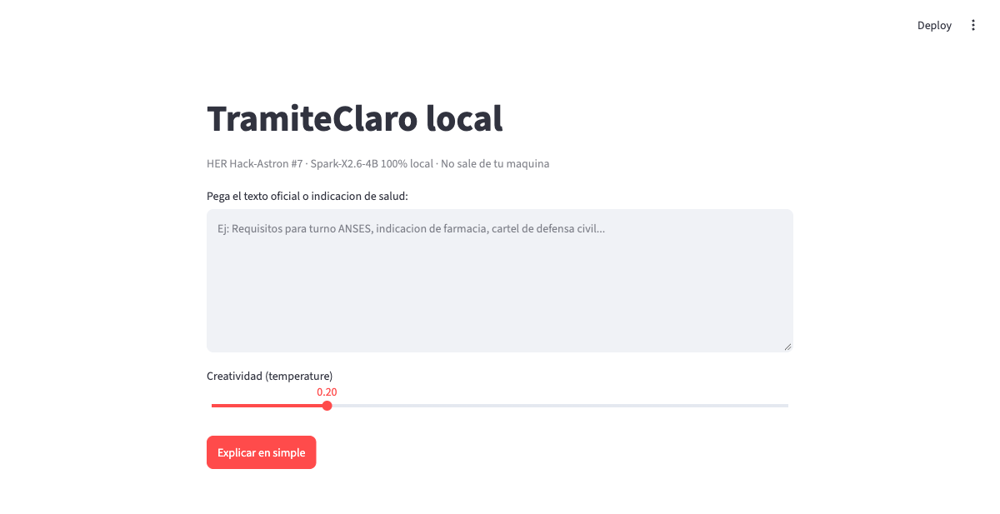
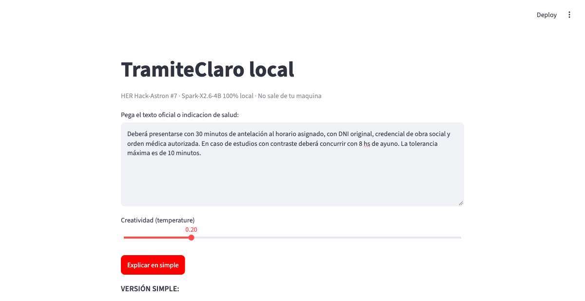

# TramiteClaro local — HER Hack-Astron #7

> Plain-language access to official and health texts, running **100% locally** with **Spark-X2.6-4B**. No cloud. No data leaves the device.

**HER Hack-Astron #7 entry:** `[HER Hack-Astron #7] [Open Source AI for Good] TramiteClaro local`
Tracks: Accessibility + Health and well-being.

Paste a confusing official text (appointment, prescription, civil-defense alert) and get back:
**VERSIÓN SIMPLE + PASOS A SEGUIR + QUÉ LLEVAR / QUÉ PREGUNTAR** — plus a safety footer. It explains, never diagnoses.




## Why this matters

Official texts are long and jargon-heavy. That causes missed appointments, medication errors, and unsafe behavior in emergencies. Vulnerable users will not paste sensitive documents into cloud chatbots. This runs offline on a 4B model, so privacy is architectural, not promised.

## Quickstart

**1. Run the model** (llama-server, OpenAI-compatible, port 8080):

```bash
llama-server \
  -m /Users/luchop/.cache/huggingface/hub/models--XHToken--Spark-X2.6-4B-GGUF/snapshots/fe31f8d64890302cc3a1d365d700357b4b75ba77/Spark-X2.6-4B-Q4_K_M.gguf \
  -c 16384 -ngl 99 --flash-attn on \
  --threads 10 --threads-batch 10 --batch-size 1024 --ubatch-size 512 \
  --port 8080 --host 0.0.0.0 --alias spark2.6-4B \
  --temp 0.2 --top-p 0.95 --top-k 20 --min-p 0.0 \
  --presence-penalty 0.0 --repeat-penalty 1.05 \
  --parallel 1 --jinja --cont-batching
```

Model: `XHToken Spark-X2.6-4B-GGUF`, file `Spark-X2.6-4B-Q4_K_M.gguf`, revision `fe31f8d64890302cc3a1d365d700357b4b75ba77`, Q4_K_M, ctx 16384, `enable_thinking: False`.

**2. Run the app:**

```bash
python3 -m venv .venv && .venv/bin/pip install -r requirements.txt
.venv/bin/python -m streamlit run app.py
# or CLI: .venv/bin/python simplificar.py ejemplos.txt
```

**3. Test without model:**

```bash
python3 -m unittest -v
```

## How it works

```
UI (app.py / simplificar.py)
  -> SimplifyTextUseCase (validate -> dedupe -> cache -> rate-limit -> LLM)
    -> LlamaServerClient (fixed local URL, timeout, enable_thinking=False)
```

- `src/domain.py` — entities, normalization, SHA cache key (deduplication).
- `src/usecase.py` — single entry point, idempotent (same input = cached output), validation, rate-limit.
- `src/llm_client.py` — thin adapter over `http://localhost:8080/v1`. No dynamic URLs (SSRF-safe).
- `src/cache.py` — TTL in-memory cache. Thread-safe.
- `src/ratelimit.py` — protects the single-slot server from flooding.
- `src/prompts.py` — Spanish system prompt, 3 fixed sections + safety footer, no diagnosis.
- `src/config.py` — single source of truth (no magic numbers scattered).

Principles: Clean Architecture (domain isolated), SOLID (DIP via `LLMPort`), KISS (stdlib + 2 deps), DRY (one config, one prompt), OWASP (input caps 20–4000 chars, timeouts, no PII logging, fail-closed errors).

## Reproducibility

Full setup, prompts, and inference settings in `docs/DISCUSSION.md`. Real verbatim outputs in `outputs/ej1-turno.md`, `ej2-farmacia.md`, `ej3-inundacion.md`. Illustrated demo in `docs/shot-*.png`. Known failure documented: EX1 fasting line is ambiguous ("8 horas antes de comer" vs "ayuno") — human review required.

## Safety scope

Explanatory aid only. Does not diagnose, dose, or triage. Always defers to human professionals. Do not paste personal data.

## License

MIT — see `LICENSE`. Model weights: Apache 2.0 by XHToken.
